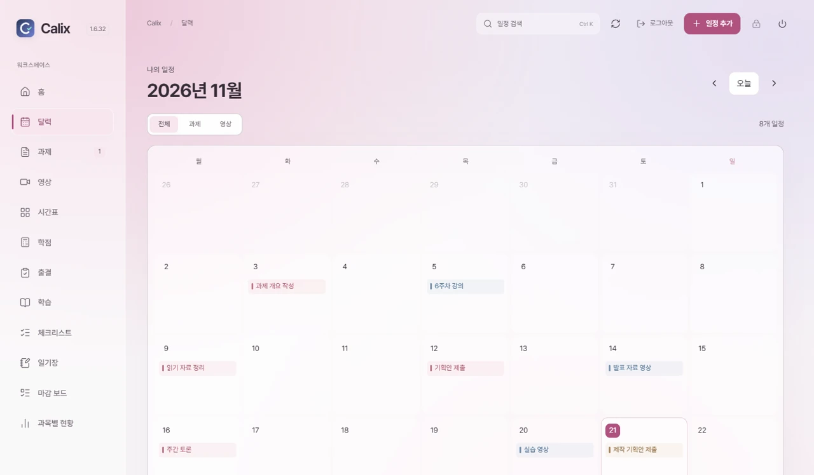

<h1 align="center">Calix</h1>

<p align="center">부산외국어대학교 Canvas 일정 관리</p>

<p align="center"><a href="https://github.com/luttechan/Calix/releases/latest"><strong>Windows 다운로드</strong></a>　<a href="https://luttechan.github.io/calix/guide/">사용 설명서</a>　<a href="https://luttechan.github.io/calix/">공식 사이트</a></p>

<p align="center">Windows 10 / 11 x64　|　1.8.1</p>

<p align="center"></p>

## 주요 기능

| 영역 | 기능 |
| --- | --- |
| Canvas | 과목별 과제, 영상, 제출 상태, 교수 코멘트, 출결 동기화 |
| 일정 | 달력, 마감 보드, 체크리스트, 학기별 시간표, 사용자 카테고리 |
| 학습 | 학점 계산, 뽀모도로, 공부 기록, 주간 통계, Anki |
| 보관 | 일기장, 저장 데이터 암호화, 백업과 복원 |

## 1.8.1

- 달력에서 드래그로 날짜 범위 선택과 개인 일정 이동.
- 시간표 기본 테마 적용 시 수업 색상 초기화.

[변경 이력](https://github.com/luttechan/Calix/releases)

<details>
<summary>소스 실행</summary>

Python 3.14.10, Node.js 24, pnpm 11, Rust, Windows C++ 빌드 도구가 필요합니다.

```powershell
pymanager install --update 3.14.10
pymanager exec -V:3.14.10 -m venv --upgrade .venv
.venv\Scripts\python -m pip install --only-binary=:all: -r requirements-build.txt brotli==1.2.1
npm install -g pnpm@11.25.0
.venv\Scripts\python main.py
```

React 미리보기는 `.venv\Scripts\python main.py --preview`로 실행합니다.

</details>

Lutté Laurent, Lutein Studio

Pretendard 기반 Calix Sans. © 2021 Kil Hyung-jin. [SIL OFL 1.1](asset/style/Pretendard-OFL.txt)
